# oopsie dataset — cleaning & standardization plan

This plan turns the raw **oopsie** corpus into a training-ready, conditioning-ready
dataset. It is derived directly from the non-destructive audit
(<https://aliang8.github.io/reports/oopsie/>, password `oopsie`), which catalogued
the dataset's structural inconsistencies, heterogeneous action spaces, duplication,
cruft, and label conventions.

## Guiding constraints

- **Non-destructive.** The raw prefix `s3://tri-ml-datasets-uw2/anthonyliang/oopsie/`
  is never deleted or mutated. Every stage writes a cleaned derivative to a new
  prefix and leaves the raw corpus as the source of truth.
- **No silent defaults.** Any episode that cannot be cleaned deterministically is
  *quarantined* with a recorded reason, not silently dropped or patched.
- **Everything is reproducible.** Each stage is a standalone, re-runnable step that
  reads the raw corpus (or the prior stage's output) and emits a machine-readable
  report plus a human-readable summary.

## Starting facts (from the audit)

- **1.89 TB, 490,288 objects, 84 top-level prefixes, 65 real contributing labs.**
  The other prefixes are source datasets, duplicates, preview assets, staging, or
  empty placeholders — not labs.
- **Action spaces are highly heterogeneous:** 12 distinct declared signatures;
  joint-position dim 5 (SO-101) → 54 (KAIST_JS humanoid); gripper 1 → 40; control
  1–50 Hz. Several labs mix action spaces *internally* (KAIST_JS, UW_REAL, UofT_TISL,
  Stanford_MSL, Princeton_PRPL, UdeM_REAL).
- **All images are external `.mp4`** — zero inline image arrays; the h5 holds path
  strings. Camera names are non-standard across labs; Toloka stores depth as mp4.
- **Temporal alignment is clean** in every lab sampled (mp4 frame count == trajectory
  length `T`; fps == `control_freq`) — but must be verified corpus-wide.
- **Optimality labels** live in `episode_annotations/<annotator>` h5 attrs
  (`success` 0/1 + `taxonomy`), populated in all 65 labs sampled and genuinely mixed;
  only CMU_Aire additionally uses success/failure *folders*.
- **Task instructions:** `language_instruction` populated in all 65 labs; ~1,887
  distinct strings across a bounded sample; only 2 single-instruction labs.
- **Duplication:** `oopsiedata-converted-v0.1` is a converted copy of SOAR_origin +
  AI2_MOLMOACT2; `oopsie-face-raw-archive` partially duplicates some labs' raw video.
- **Cruft:** USP_MB ships 15,498 `*.ext.hidden` byte-identical shadow copies
  (~doubles that lab); UW_REAL has 50 `.h5.bak`; stray `.DS_Store`, `.zip`.
- **Defects:** CMU_Auton has ≥1 zero-frame, 261-byte mp4 container.
- **15 empty placeholder prefixes** (only a `.gitattributes`, no data).

## Pipeline

```dot
digraph oopsie_clean {
  rankdir=LR; node [shape=box, style=rounded];
  raw   [label="raw oopsie/\n(oopsiedata_format_v1)"];
  s1    [label="1. Scope &\nprefix taxonomy"];
  s2    [label="2. Dedup"];
  s3    [label="3. Cruft &\ndefect quarantine"];
  s4    [label="4. Schema\nvalidation"];
  s5    [label="5. Action-space\nharmonization"];
  s6    [label="6. Camera/modality\nstandardization"];
  s7    [label="7. Alignment\nverification"];
  s8    [label="8. Optimality-label\nconsolidation"];
  s9    [label="9. Instruction\nnormalization"];
  s10   [label="10. Metadata\nmanifest"];
  clean [label="oopsie_clean/\n(oopsiedata_format_v2)\n+ manifest.parquet", shape=box, style="rounded,filled", fillcolor="#e8f5e9"];
  raw -> s1 -> s2 -> s3 -> s4 -> s5 -> s6 -> s7 -> s8 -> s9 -> s10 -> clean;
}
```



## Stages

### 1. Scope & prefix taxonomy
Classify all 84 top-level prefixes into: **real lab** (65), **source/origin**
(SOAR_origin, AutoEval_origin, …), **duplicate** (oopsiedata-converted-v0.1,
oopsie-face-raw-archive), **preview** (WebVisualizer, Visualizer_Previews),
**staging** (roboarena_upload), and **empty placeholder** (15). Emit an explicit
include/exclude list; by default only real-lab data flows downstream. Output:
`reports/prefix_taxonomy.json`.

### 2. Deduplication
Content-hash (size + hash of h5 bytes and mp4 bytes) across the included set and the
duplicate prefixes to prove `oopsiedata-converted-v0.1` and `oopsie-face-raw-archive`
are redundant, then exclude them. Detect any cross-lab byte-identical episodes.
Output: dedup manifest with the kept canonical copy per hash.

### 3. Cruft & defect quarantine
Exclude from the cleaned copy (never delete from raw): `*.ext.hidden` shadow copies
(USP_MB, ~15.5k), `.h5.bak` (UW_REAL, 50), `.DS_Store`, `.zip`. Detect and quarantine
corrupt/zero-frame mp4 (e.g. CMU_Auton's 261-byte container) and truncated h5. Output:
`reports/quarantine.jsonl` (path + reason).

### 4. Schema validation
Validate every episode against `oopsiedata_format_v1`: required root attrs
(`episode_id`, `lab_id`, `language_instruction`, `operator_name`, `robot_profile`),
presence of `observations/robot_states`, consistent/empty `actions/` slots, and
resolvable `observations/video_paths/<cam>` pointers. Episodes failing validation are
quarantined with the specific violation. Output: per-episode validation record.

### 5. Action-space harmonization
Resolve the 12 signatures to a **common padded action vector** plus a per-episode
`action_dim_valid` mask keyed by embodiment (the convention already proven in the
pi05 / vla_foundry metadata-conditioning work). Record each episode's native action
signature and the mapping into the common layout. Flag (do not silently merge) labs
that mix action spaces internally. Output: action-space mapping table + the harmonized
`actions/` group in v2.

### 6. Camera / modality standardization
Normalize non-standard camera names to canonical roles (`exterior` / third-person,
`wrist_left`, `wrist_right`, `wrist`, `depth`, …) with a per-episode camera-role map;
preserve the original names. Record resolution/fps per camera. Handle depth-as-mp4
(Toloka). Output: camera-role map per episode.

### 7. Alignment verification
Corpus-wide: assert mp4 frame count == trajectory `T` and fps == `control_freq` for
every episode and camera (audit confirmed clean on 18 labs; verify the rest).
Mismatches are quarantined. Output: alignment report.

### 8. Optimality-label consolidation
Consolidate the scattered success/failure signal into a single uniform per-episode
field: prefer `episode_annotations/<annotator>.success` (+ `taxonomy.outcome`), fall
back to CMU_Aire's folder convention, else mark `optimality=unknown`. Never infer.
Output: per-episode `success`, `failure_category`, `severity`, `annotator`,
`label_source`.

### 9. Instruction normalization
Normalize `language_instruction` (trim, collapse whitespace, preserve case for display
but index a normalized key), catalog the distinct instruction set per lab and
corpus-wide, and cluster near-duplicates for inspection (no auto-merge). Output:
instruction catalog + per-episode normalized key.

### 10. Metadata manifest
Emit one row per cleaned episode to `manifest.parquet` (+ jsonl) with the axes needed
for metadata/suboptimality-conditioned pretraining: `episode_id, lab_id, embodiment
(robot_name/is_biarm/gripper), operator_name, success, taxonomy, speed_bucket (derived:
mean |Δaction|×control_freq, quantile-bucketed), language_instruction (+ normalized
key), cameras (roles), native action signature, T, fps, data paths`. This manifest is
the direct input to the pi07-style conditioning pipeline.

## Output contract

- Cleaned corpus: `s3://tri-ml-datasets-uw2/anthonyliang/oopsie_clean/` (proposed),
  schema **`oopsiedata_format_v2`** (harmonized actions + canonical camera roles +
  consolidated optimality + normalized instruction key).
- `manifest.parquet` / `manifest.jsonl` — one row per episode.
- `reports/` — one machine-readable report per stage, plus a top-level summary.
- Raw `oopsie/` is read-only throughout.

## Phasing

1. **Phase A — inventory (read-only):** stages 1–4 and 7. Produces the taxonomy, dedup
   manifest, quarantine list, validation records, and alignment report. No data
   written beyond reports. This alone makes the dataset safely usable as-is.
2. **Phase B — harmonization:** stages 5, 6, 8, 9 and the stage-10 manifest. Writes
   `oopsie_clean/` + manifest.
3. **Phase C — conditioning handoff:** wire the manifest into the pi05 / vla_foundry
   metadata-conditioning converters so pretraining reads `oopsie_clean/` directly.

## Repo layout

```
oopsie_processing/
  README.md
  PLAN.md              <- this file
  src/oopsie_processing/
    stage1_taxonomy.py ... stage10_manifest.py   (land per phase)
    common/            (s3 streaming, h5 io, reports)
  reports/             (generated; gitignored)
  configs/             (per-stage YAML; no silent defaults)
```
